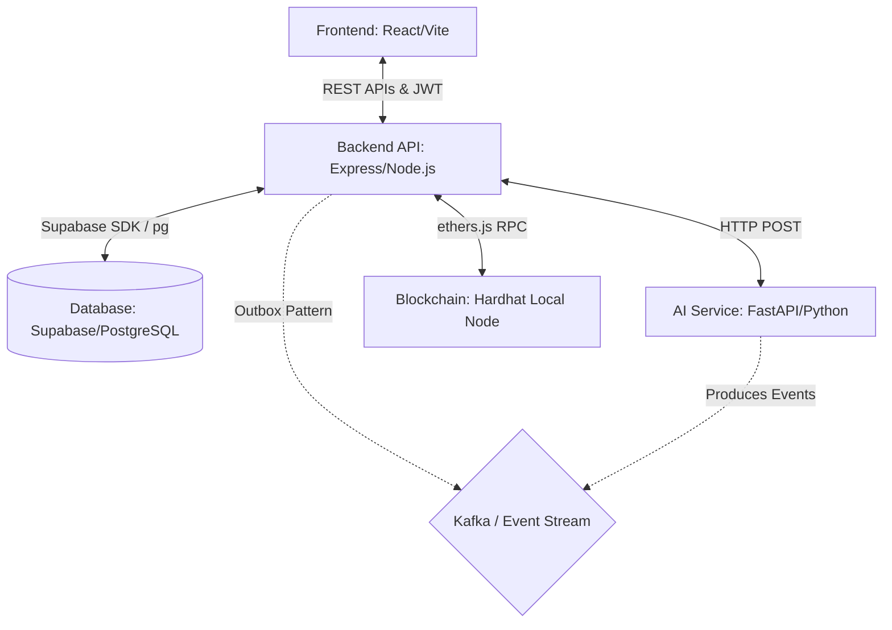

# Architecture Baseline

The Farm-to-Fork Tracker utilizes a microservices-inspired architecture designed to integrate a traditional Web2 backend with AI processing and Web3 blockchain records.

## System Diagram

## Component Details

### 1. Frontend
- **Framework:** React + Vite + TypeScript.
- **Role:** Handles user interfaces, dashboard routing, and QR code rendering/scanning.

### 2. Backend API
- **Framework:** Node.js with Express and TypeScript.
- **Role:** Central business logic layer. All frontend requests go here. Handles authentication (JWT creation/validation), interacts with the database (Supabase), calls the AI service for predictions, and submits transactions to the blockchain via `ethers.js`.

### 3. Database
- **Framework:** Supabase (managed PostgreSQL).
- **Role:** Stores relational data (users, products, shipments, inventory). The backend connects via the Supabase Service Role key, bypassing Row Level Security (RLS) to act as a centralized authority.

### 4. AI Service
- **Framework:** FastAPI with Python.
- **Role:** Provides endpoints for crop quality, shelf-life, and price predictions. Mostly mock endpoints currently, except for the XGBoost price prediction model.

### 5. Blockchain
- **Framework:** Hardhat local node running `FarmChain.sol`.
- **Role:** Acts as an immutable ledger for critical supply chain milestones (Product Registration, Stage Updates, Ownership Transfers, Retail Receipts).

### 6. Kafka / Event System
- **Framework:** Confluent Kafka (partially implemented).
- **Role:** Designed for asynchronous event streaming (Traceability Events, Inventory Updates). The backend currently uses a Transactional Outbox pattern (`event_outbox` table) to prepare events for Kafka.
