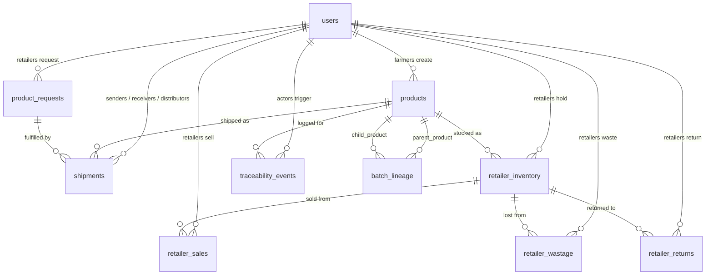
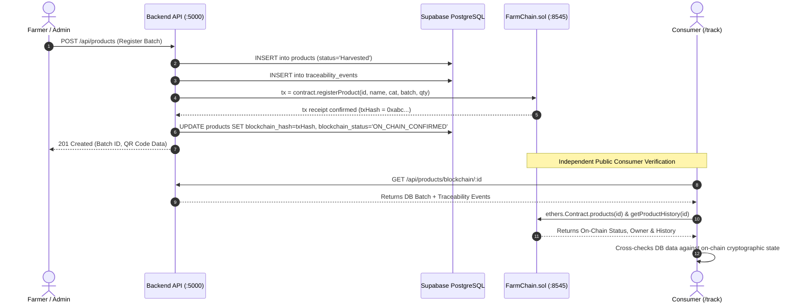

# FarmChainAI (Farm-to-Fork Tracker) — Technical Architecture & Knowledge Base

> **Document Type:** Senior Software Architect Technical Knowledge Base
> **Target Project:** FarmChainAI (Farm-to-Fork Tracker)
> **Repository Root:** `.` (Repository Root)
> **Classification:** Project Technical Documentation & System Inventory
> **Audit Date:** October 2026

---

## Executive Summary

**FarmChainAI** is an enterprise-grade agricultural supply-chain traceability platform. It integrates a Web2 relational database layer (PostgreSQL / Supabase), a Web3 decentralized ledger (Ethereum EVM smart contracts via Hardhat), and an AI microservice (Python / FastAPI / XGBoost) to provide transparent, tamper-proof tracking of agricultural produce from seed harvest to final consumer purchase.

The platform provides role-based interfaces for **Farmers**, **Processors**, **Distributors**, **Retailers**, **Platform Administrators**, and public **Consumers**. Every custody transfer, processing transformation, quality inspection, and retail sale is logged in relational storage and verifiable against smart contract records.

---

## 1. Project Purpose, Architecture, Technology Stack, and Service Communication

### 1.1 Purpose and Core Mission
- **Traceability:** Provide immutable, verifiable tracking of agricultural produce through each stage of the supply chain.
- **Fraud Mitigation:** Prevent counterfeit labeling, duplicate batch injection, and chronological timestamp tampering using cryptographic verification.
- **Wastage Reduction:** Use AI market forecasting and operational decision-support rules to monitor near-expiry stock and dynamically recommend priority actions.
- **Consumer Trust:** Allow consumers to scan a QR code on product packaging to view the journey of their produce, farm origin, and verified handlers.

### 1.2 System Architecture Diagram

```mermaid
flowchart TB
    subgraph ClientLayer ["Client Layer (Browser)"]
        ConsumerApp["Public Consumer (/track)"]
        FarmerUI["Farmer Dashboard (/farmer)"]
        ProcessorUI["Processor Dashboard (/processor)"]
        DistributorUI["Distributor Dashboard (/distributor)"]
        RetailerUI["Retailer Dashboard (/retailer)"]
        AdminUI["Admin Dashboard (/admin)"]
    end

    subgraph APILayer ["Backend API Layer (Node.js/Express :5000)"]
        APIRouter["Express HTTP Router & Middleware (JWT/RBAC/RateLimit)"]
        Controllers["Controllers (Product, Shipments, Retailer, Anomaly)"]
        BCService["Blockchain Service (ethers.js v6)"]
        DecisionEngine["Decision Support Service"]
        AuditService["AI Audit Service"]
    end

    subgraph DataLayer ["Data & Event Layer"]
        SupabaseDB[("PostgreSQL 15 (Supabase :54321/:54322)\nRow Level Security + Atomic Stored Procedures")]
        EventOutbox[("Transactional Event Outbox\n(event_outbox table)")]
        StorageBucket["Supabase Storage: product-images (Public)"]
    end

    subgraph AIServiceLayer ["AI Microservice Layer (Python/FastAPI :8000)"]
        FastAPIApp["FastAPI Engine"]
        XGBoostModel["XGBoost Price Regressor v1.0.0"]
        MLPipeline["Feature Engineering & Time-Series Pipeline"]
    end

    subgraph Web3Layer ["Decentralized Ledger (Hardhat EVM :8545)"]
        HardhatNode["Hardhat Local EVM Node (Chain ID 31337)"]
        FarmChainContract["FarmChain.sol Smart Contract"]
    end

    %% Communication Flows
    ClientLayer <-->|HTTPS / REST / JWT| APIRouter
    ConsumerApp -.->|Direct RPC read (ethers.js)| FarmChainContract
    APIRouter --> Controllers
    Controllers <-->|PostgREST / Service Role Key| SupabaseDB
    Controllers --> BCService
    Controllers --> DecisionEngine
    Controllers --> AuditService
    Controllers <-->|HTTP POST /api/farmer/price-prediction| FastAPIApp
    BCService <-->|JSON-RPC ethers.js| FarmChainContract
    SupabaseDB --> EventOutbox
    FastAPIApp <-->|Direct SQL Historical Sync| SupabaseDB
```

### 1.3 Technology Stack Breakdown

| Layer | Technologies & Libraries | Version / Notes |
| :--- | :--- | :--- |
| **Frontend** | React 18, Vite 5, TypeScript 5, Tailwind CSS, Lucide React, Axios, `qrcode.react`, `html5-qrcode`, `jsqr`, `ethers.js` v6 | Single Page App served on port `5173`. Uses client-side routing via React Router DOM v6. |
| **Backend API** | Node.js 20+, Express 4, TypeScript, `tsx`, `cors`, `dotenv`, `bcryptjs`, `jsonwebtoken`, `express-rate-limit`, `@supabase/supabase-js` v2 | Core orchestrator on port `5000`. Connects to Supabase via Service Role key to bypass RLS. |
| **Database** | PostgreSQL 15 via Supabase Local Stack, PL/pgSQL Stored Procedures | Running on port `54321` (API) and `54322` (DB). Atomic transactions utilize `FOR UPDATE` row locks. |
| **AI Microservice** | Python 3.10+, FastAPI, Uvicorn, XGBoost, Scikit-learn, Pandas, NumPy, Pydantic | High-performance machine learning inference engine on port `8000`. |
| **Blockchain** | Solidity `^0.8.24`, Hardhat, Ethers.js v6, Hardhat Network | EVM execution environment on port `8545` (Chain ID: `31337`). |
| **Event Streaming** | Confluent Kafka Client / Transactional Outbox Pattern | Outbox tables buffer events; Kafka client incorporates graceful fallback on OS policy restrictions. |

### 1.4 Inter-Service Communication Protocols
1. **Frontend $\leftrightarrow$ Backend:** HTTP/1.1 REST JSON. Authenticated via `Authorization: Bearer <JWT>` headers. CORS configured for explicit origin reflection with credential support.
2. **Backend $\leftrightarrow$ Database:** `@supabase/supabase-js` connecting via HTTP PostgREST API and Postgres RPC for stored procedures (`record_retailer_sale`, `record_retailer_wastage`, `record_retailer_return`).
3. **Backend $\leftrightarrow$ AI Microservice:** Synchronous HTTP POST requests (e.g. `POST http://127.0.0.1:8000/api/farmer/price-prediction`) with timeout guards.
4. **Backend $\leftrightarrow$ Blockchain:** JSON-RPC over HTTP to local Hardhat node (`http://127.0.0.1:8545`), signing transactions via backend service wallet.
5. **Frontend $\leftrightarrow$ Blockchain (Public Tracker):** Direct JSON-RPC read calls via `ethers.JsonRpcProvider` directly querying `FarmChain.sol` for independent on-chain verification.

---

## 2. User Roles, Frontend Pages, and Implemented Features

### 2.1 Role: Platform Administrator (`admin`)
- **Dashboard (`/admin`):**
  - **Component:** [`Dashboard.tsx`](./frontend/src/pages/Dashboard.tsx)
  - **Features:** Platform KPIs (active users, total batches, verified deliveries, alert counts), blockchain node health status, quick links to platform management.
- **User Management (`/admin/users`, `/admin/users/:id`):**
  - **Components:** [`AdminUsers.tsx`](./frontend/src/pages/admin/AdminUsers.tsx), [`AdminUserDetails.tsx`](./frontend/src/pages/admin/AdminUserDetails.tsx)
  - **Features:** View all registered actors, filter by role/status, approve pending role registrations, view actor transaction history and assigned inventory.
- **Product Approvals (`/admin/products`, `/admin/products/:id`):**
  - **Components:** [`AdminProducts.tsx`](./frontend/src/pages/admin/AdminProducts.tsx), [`AdminProductDetails.tsx`](./frontend/src/pages/admin/AdminProductDetails.tsx)
  - **Features:** Inspect batch registration metadata, examine images and AI quality scores, trigger blockchain smart contract minting (`PUT /api/admin/products/:id/approve`).
- **Analytics & Anomaly Dashboards:**
  - **Components:** [`AnalyticsDashboard.tsx`](./frontend/src/pages/AnalyticsDashboard.tsx), [`SupplyChainAnalytics.tsx`](./frontend/src/pages/analytics/SupplyChainAnalytics.tsx), [`AnomalyDetection.tsx`](./frontend/src/pages/analytics/AnomalyDetection.tsx), [`AIObservability.tsx`](./frontend/src/pages/analytics/AIObservability.tsx)
  - **Features:** Volume trends, chronological anomaly inspection (temporal jumps, missing predecessor custody events, duplicate entries), AI drift metrics, inference latency graphs.

### 2.2 Role: Farmer (`farmer`)
- **Main Dashboard (`/farmer`):**
  - **Component:** [`FarmerDashboard.tsx`](./frontend/src/pages/FarmerDashboard.tsx)
  - **Features:** Register new harvest produce batches (crop name, category, quantity, price per kg, harvest date, expiry date, farm coordinates, product image upload). Generates and renders SVG/Canvas QR codes with instant print and download.
- **Product Inventory (`/farmer/products`):**
  - **Component:** [`MyProductsPage.tsx`](./frontend/src/pages/MyProductsPage.tsx)
  - **Features:** Tabular list of farmer batches, status badges (`Harvested`, `Pending Approval`, `Delivered`), QR code retrieval modal.
- **AI Services (`/farmer/ai-services`):**
  - **Component:** [`FarmerAIServices.tsx`](./frontend/src/pages/FarmerAIServices.tsx)
  - **Features:** Real XGBoost market price forecasting for commodities across regional markets, multi-day price projection charts, honest indicator states for unmodeled services.
- **B2B Demand Requests (`/farmer/requests`):**
  - **Component:** [`FarmerRequestsPage.tsx`](./frontend/src/pages/FarmerRequestsPage.tsx)
  - **Features:** View incoming purchase requests created by processors or retailers, accept or dispatch stock to fulfill demand.
- **Analytics & Notifications (`/farmer/analytics`, `/farmer/notifications`):**
  - **Components:** [`FarmerAnalyticsPage.tsx`](./frontend/src/pages/FarmerAnalyticsPage.tsx), [`FarmerNotificationsPage.tsx`](./frontend/src/pages/FarmerNotificationsPage.tsx)
  - **Features:** Revenue analytics, harvest volume distribution, real-time dispatch alerts and notifications.

### 2.3 Role: Processor (`processor`)
- **Main Dashboard (`/processor`):**
  - **Component:** [`ProcessorDashboard.tsx`](./frontend/src/pages/ProcessorDashboard.tsx)
  - **Features:**
    - Live QR Scanner: Camera video scanner or image file parser for incoming farmer shipments.
    - Shipment Acceptance: Verify incoming farmer batch, confirm receipt, mark shipment `DELIVERED`.
    - Batch Processing & Transformation: Converts raw harvest into processed output (e.g. Raw Milk $\rightarrow$ Pasteurized Cheese). Captures processing method, hygiene inspection, waste loss %, yield grade, and links parent-to-child lineage.
    - Outbound Shipment Creation: Assigns downstream shipments to distributors for delivery to retailers.

### 2.4 Role: Distributor (`distributor`)
- **Main Dashboard (`/distributor`):**
  - **Component:** [`DistributorDashboard.tsx`](./frontend/src/pages/DistributorDashboard.tsx)
  - **Features:**
    - Assigned Shipments: View shipments scheduled for pickup.
    - Dispatch & Transit Updates: Update status to `IN_TRANSIT`, log vehicle registration, driver details, and route waypoints.
    - Cold-Chain Telemetry: Capture storage temperature and humidity readings during transit.
    - Delivery Handover: Mark arrival at destination, updating custody records.

### 2.5 Role: Retailer (`retailer`)
- **Retailer Hub (`/retailer`):**
  - **Component:** [`pages/retailer/Dashboard.tsx`](./frontend/src/pages/retailer/Dashboard.tsx)
  - **Features:** Executive overview of retail stock levels, low-stock warnings, today's revenue, and active alerts.
- **Procurement & Requests (`/retailer/requests`):**
  - **Component:** [`ProductRequests.tsx`](./frontend/src/pages/retailer/ProductRequests.tsx)
  - **Features:** Create B2B product requests specifying commodity, quantity, required date, and notes.
- **Shipment Intake & Verification (`/retailer/shipments`, `/retailer/receive`):**
  - **Components:** [`Shipments.tsx`](./frontend/src/pages/retailer/Shipments.tsx), [`ReceiveProduct.tsx`](./frontend/src/pages/retailer/ReceiveProduct.tsx)
  - **Features:** Inbound shipment tracking, live QR scanning to cross-verify batch number against carrier manifest, confirmation of physical intake into inventory.
- **Inventory & Shelf Management (`/retailer/inventory`, `/retailer/expiry`):**
  - **Components:** [`Inventory.tsx`](./frontend/src/pages/retailer/Inventory.tsx), [`Expiry.tsx`](./frontend/src/pages/retailer/Expiry.tsx)
  - **Features:** Real-time stock counts, status indicators (`AVAILABLE`, `DEPLETED`), expiry countdown clocks.
- **Operations: Sales, Wastage & Returns (`/retailer/sales`, `/retailer/wastage`, `/retailer/returns`):**
  - **Components:** [`Sales.tsx`](./frontend/src/pages/retailer/Sales.tsx), [`Wastage.tsx`](./frontend/src/pages/retailer/Wastage.tsx), [`Returns.tsx`](./frontend/src/pages/retailer/Returns.tsx)
  - **Features:** Execute atomic point-of-sale transactions, report spoiled/damaged goods with reasons, handle customer returns with restock/waste branching.
- **Alerts & Batch History (`/retailer/alerts`, `/retailer/traceability`):**
  - **Components:** [`Alerts.tsx`](./frontend/src/pages/retailer/Alerts.tsx), [`Traceability.tsx`](./frontend/src/pages/retailer/Traceability.tsx)
  - **Features:** Reactive alerts for stock nearing expiry or depleted thresholds; comprehensive batch journey viewer.

### 2.6 Public / Consumer
- **Landing Page (`/`):**
  - **Component:** [`LandingPage.tsx`](./frontend/src/pages/LandingPage.tsx)
  - **Features:** Hero section, feature walkthrough, quick batch tracker input.
- **Consumer Traceability Portal (`/track`, `/tracker`, `/verify`):**
  - **Component:** [`Tracker.tsx`](./frontend/src/pages/Tracker.tsx)
  - **Features:** Search by batch number or 6-digit ID, live camera QR scanner, image upload scanner. Displays full chronological timeline of verified custody events, blockchain authenticity hash, origin farm details, harvest timestamp, and missing-record warnings.

---

## 3. Frontend Routes, Components, Forms, Dashboards, and API Integrations

### 3.1 Complete Frontend Route Table

| URL Path | Component | Auth & Role Guard | Primary Backend APIs |
| :--- | :--- | :--- | :--- |
| `/` | `LandingPage.tsx` | Public | None |
| `/track`, `/tracker`, `/verify` | `Tracker.tsx` | Public | `GET /api/products/blockchain/:id`, `GET /api/products` |
| `/login` | `LoginPage.tsx` | Public | `POST /api/auth/login` |
| `/register` | `RegisterPage.tsx` | Public | `POST /api/auth/register` |
| `/admin` | `Dashboard.tsx` | `admin` | `GET /api/admin/stats` |
| `/admin/analytics` | `AnalyticsDashboard.tsx` | `admin` | `GET /api/admin/analytics` |
| `/admin/supply-chain-analytics` | `SupplyChainAnalytics.tsx` | `admin` | `GET /api/analytics/supply-chain` |
| `/admin/anomaly-detection` | `AnomalyDetection.tsx` | `admin` | `GET /api/analytics/anomalies` |
| `/admin/ai-observability` | `AIObservability.tsx` | `admin` | `GET /api/analytics/ai-observability` |
| `/admin/users` | `AdminUsers.tsx` | `admin` | `GET /api/admin/users`, `PUT /api/admin/users/:id/role` |
| `/admin/users/:id` | `AdminUserDetails.tsx` | `admin` | `GET /api/admin/users/:id/details` |
| `/admin/products` | `AdminProducts.tsx` | `admin` | `GET /api/products`, `PUT /api/admin/products/:id/approve` |
| `/admin/products/:id` | `AdminProductDetails.tsx` | `admin` | `GET /api/admin/products/:id/details` |
| `/farmer` | `FarmerDashboard.tsx` | `farmer`, `admin` | `GET /api/products/my`, `POST /api/products` |
| `/farmer/products` | `MyProductsPage.tsx` | `farmer`, `admin` | `GET /api/products/my` |
| `/farmer/ai-services` | `FarmerAIServices.tsx` | `farmer`, `admin` | `POST /api/farmer/price-prediction` |
| `/farmer/requests` | `FarmerRequestsPage.tsx` | `farmer`, `admin` | `GET /api/farmer/requests` |
| `/farmer/analytics` | `FarmerAnalyticsPage.tsx` | `farmer`, `admin` | `GET /api/farmer/analytics` |
| `/farmer/notifications` | `FarmerNotificationsPage.tsx` | `farmer`, `admin` | `GET /api/notifications` |
| `/processor` | `ProcessorDashboard.tsx` | `processor`, `admin` | `GET /api/processor/shipments/incoming`, `POST /api/processor/process`, `POST /api/processor/shipments` |
| `/distributor` | `DistributorDashboard.tsx` | `distributor`, `admin` | `GET /api/distributor/shipments`, `POST /api/distributor/shipments/:id/status` |
| `/retailer` | `RetailerDashboard.tsx` | `retailer`, `admin` | `GET /api/retailer/dashboard`, `GET /api/decisions` |
| `/retailer/requests` | `RetailerProductRequests.tsx` | `retailer`, `admin` | `GET /api/retailer/requests`, `POST /api/retailer/requests` |
| `/retailer/shipments` | `RetailerShipments.tsx` | `retailer`, `admin` | `GET /api/retailer/shipments` |
| `/retailer/receive` | `RetailerReceiveProduct.tsx` | `retailer`, `admin` | `POST /api/retailer/verify-batch`, `POST /api/retailer/receive-product` |
| `/retailer/inventory` | `RetailerInventory.tsx` | `retailer`, `admin` | `GET /api/retailer/inventory` |
| `/retailer/sales` | `RetailerSales.tsx` | `retailer`, `admin` | `GET /api/retailer/sales`, `POST /api/retailer/sales` |
| `/retailer/wastage` | `RetailerWastage.tsx` | `retailer`, `admin` | `GET /api/retailer/wastage`, `POST /api/retailer/wastage` |
| `/retailer/expiry` | `RetailerExpiry.tsx` | `retailer`, `admin` | `GET /api/retailer/inventory` |
| `/retailer/returns` | `RetailerReturns.tsx` | `retailer`, `admin` | `GET /api/retailer/returns`, `POST /api/retailer/returns` |
| `/retailer/alerts` | `RetailerAlerts.tsx` | `retailer`, `admin` | `GET /api/retailer/inventory` |
| `/retailer/traceability` | `RetailerTraceability.tsx` | `retailer`, `admin` | `GET /api/retailer/traceability/:batch_number` |

---

## 4. Backend Routes, Controllers, Middleware, Services, and Business Logic

### 4.1 Route & Controller Mapping

```
backend/src/
├── routes/
│   ├── adminRoutes.ts          --> adminController.ts
│   ├── aiRoutes.ts             --> aiController.ts
│   ├── analyticsRoutes.ts      --> analyticsController.ts
│   ├── anomalyRoutes.ts        --> anomalyController.ts
│   ├── authRoutes.ts           --> authController.ts
│   ├── decisionRoutes.ts       --> decisionController.ts
│   ├── distributorRoutes.ts    --> distributorController.ts
│   ├── farmerRoutes.ts         --> farmerController.ts
│   ├── notificationRoutes.ts   --> notificationController.ts
│   ├── processorRoutes.ts      --> processorController.ts
│   ├── productRoutes.ts        --> productController.ts
│   └── retailerRoutes.ts       --> retailerController.ts
├── middleware/
│   ├── auth.ts                 (protect, authorize)
│   └── rateLimit.ts            (generalLimiter, authLimiter)
└── services/
    ├── aiAuditService.ts
    ├── blockchainService.ts
    └── decisionSupportService.ts
```

### 4.2 Detailed Route Inventory & Permissions

#### Authentication (`/api/auth`)
- `POST /register`: Registers new user in `public.users` table with bcrypt password hashing (10 salt rounds).
- `POST /login`: Validates email/password; returns JWT containing `{ id, role }`.
- `PUT /status` (Protected): Updates actor availability status (`AVAILABLE`, `BUSY`, `OFFLINE`).
- `GET /distributors` (Protected): Returns list of active distributors.

#### Products (`/api/products`)
- `GET /` (Protected): Retrieves all products in system.
- `GET /blockchain/:id` (Public): Public endpoint querying single product and associated `traceability_events` for consumer tracking.
- `GET /my` (Protected, `farmer`): Retrieves products owned by current logged-in farmer.
- `POST /` (Protected, `farmer`, `admin`): Registers produce batch. Uploads image to Supabase storage bucket `product-images`. Automatically records initial `traceability_events` entry.
- `PUT /:id/status` (Protected): Updates lifecycle status and ownership.
- `DELETE /:id` (Protected, `farmer`, `admin`): Deletes unapproved or draft batches.

#### Processor (`/api/processor`)
- `GET /shipments/incoming` (Protected, `processor`, `admin`): Returns incoming shipments directed to this processor.
- `POST /shipments/:id/receive` (Protected, `processor`, `admin`): Acknowledges receipt of farmer shipment.
- `POST /process` (Protected, `processor`, `admin`): Executes batch transformation:
  - Validates source product exists and has sufficient quantity.
  - Creates child product batch in `products`.
  - Inserts parent-to-child lineage row into `batch_lineage`.
  - Inserts `PROCESSED` event into `traceability_events`.
- `POST /shipments` (Protected, `processor`, `admin`): Creates outbound shipment to retailer, assigned to distributor.

#### Distributor (`/api/distributor`)
- `GET /shipments` (Protected, `distributor`, `admin`): Returns all assigned logistics shipments.
- `POST /shipments/:id/pickup` (Protected, `distributor`, `admin`): Updates shipment status to `IN_TRANSIT`.
- `POST /shipments/:id/status` (Protected, `distributor`, `admin`): Updates transit milestones and cold-chain sensor readings.
- `POST /shipments/:id/deliver` (Protected, `distributor`, `admin`): Marks shipment as `DELIVERED` at destination.

#### Retailer (`/api/retailer`)
- `POST /requests` (Protected, `retailer`, `admin`): Creates B2B procurement request in `product_requests`.
- `GET /requests` (Protected, `retailer`, `admin`): Lists requests for logged-in retailer.
- `GET /shipments` (Protected, `retailer`, `admin`): Lists inbound shipments.
- `POST /verify-batch` (Protected, `retailer`, `admin`): Verifies batch authenticity against supplier and shipment records before physical intake.
- `POST /receive-product` (Protected, `retailer`, `admin`): Confirms delivery intake. Adds inventory to `retailer_inventory`, marks shipment `RECEIVED`, and registers blockchain status.
- `GET /inventory` (Protected, `retailer`, `admin`): Fetches stock balances.
- `POST /sales` (Protected, `retailer`, `admin`): Invokes `record_retailer_sale` stored procedure. Atomically decrements inventory, creates `retailer_sales` record, and adds outbox event.
- `GET /sales` (Protected, `retailer`, `admin`): Fetches historical sales.
- `POST /wastage` (Protected, `retailer`, `admin`): Invokes `record_retailer_wastage` stored procedure. Logs spoiled goods, decrements inventory.
- `GET /wastage` (Protected, `retailer`, `admin`): Fetches wastage audit history.
- `POST /returns` (Protected, `retailer`, `admin`): Invokes `record_retailer_return` stored procedure. Supports either returning to shelf (restock) or writing off as damaged.
- `GET /returns` (Protected, `retailer`, `admin`): Fetches customer return log.
- `GET /dashboard` (Protected, `retailer`, `admin`): Aggregate statistics (total inventory, active batches, low-stock count, gross revenue).

#### Anomaly Detection & Observability (`/api/analytics`)
- `GET /anomalies` (Protected, `admin`): Executes deterministic sequence and temporal rules across all `traceability_events`:
  1. *Impossible Event Sequence (CRITICAL):* Downstream event exists without preceding upstream event.
  2. *Temporal Anomaly (CRITICAL):* Chronological timestamps violate physical cause-and-effect.
  3. *Duplicate Lifecycle Event (MEDIUM):* Redundant stage recordings for a single batch.
- `GET /ai-observability` (Protected, `admin`): Summarizes AI capability status, error rates, model versions, and audit logs.

#### Operational Decision Support (`/api/decisions`)
- `GET /` (Protected, `farmer`, `processor`, `distributor`, `retailer`, `admin`): Role-tailored decision engine. Evaluates database states to generate actionable operational signals (`EXPIRY_RISK`, `LOW_INVENTORY`, `SHIPMENT_ACTION_REQUIRED`).

---

## 5. Database Tables, Relationships, Migrations, Triggers, RLS, and Stored Procedures

### 5.1 Database Entity Relationship Summary



### 5.2 Schema Table Inventory

1. **`users`:** Stores platform user identities.
   - Columns: `id` (UUID PK), `name`, `email` (Unique), `password` (bcrypt), `role` (`farmer`, `processor`, `distributor`, `retailer`, `admin`), `wallet_address`, `availability_status`, `created_at`, `updated_at`.
2. **`products`:** Core agricultural batch entity.
   - Columns: `id` (UUID PK), `product_id` (Integer blockchain ID), `name`, `category`, `batch_number` (Text Unique), `quantity`, `unit`, `price`, `farm_location`, `harvest_date`, `expiry_date`, `farmer_id` (FK $\rightarrow$ `users.id`), `current_owner_id` (FK $\rightarrow$ `users.id`), `status`, `blockchain_hash`, `blockchain_status`, `ai_quality_score`, `ai_quality_label`, `ai_shelf_life`, `product_image_url`, `created_at`, `updated_at`.
3. **`batch_lineage`:** Parent-to-child transformation mapping.
   - Columns: `id` (UUID PK), `parent_product_id` (FK $\rightarrow$ `products.id`), `child_product_id` (FK $\rightarrow$ `products.id`), `processing_action`, `quantity_used`, `created_at`.
   - Constraints: `chk_no_self_reference` (`parent_product_id != child_product_id`).
4. **`product_requests`:** B2B commercial orders between supply chain tiers.
   - Columns: `id` (UUID PK), `request_id`, `retailer_id` (FK $\rightarrow$ `users.id`), `processor_id` (FK $\rightarrow$ `users.id`), `product_name`, `quantity`, `unit`, `required_date`, `status`, `created_at`, `updated_at`.
5. **`shipments`:** Physical transport logistics manifests.
   - Columns: `id` (UUID PK), `shipment_tracking_id`, `request_id` (FK $\rightarrow$ `product_requests.id`), `product_id` (FK $\rightarrow$ `products.id`), `batch_number`, `quantity`, `sender_id` (FK $\rightarrow$ `users.id`), `receiver_id` (FK $\rightarrow$ `users.id`), `distributor_id` (FK $\rightarrow$ `users.id`), `status` (`CREATED`, `ASSIGNED`, `IN_TRANSIT`, `DELIVERED`, `RECEIVED`), `created_at`, `updated_at`.
6. **`retailer_inventory`:** Retail shelf stock balances.
   - Columns: `id` (UUID PK), `retailer_id` (FK $\rightarrow$ `users.id`), `product_id` (FK $\rightarrow$ `products.id`), `batch_number`, `product_name`, `quantity`, `unit`, `price_per_unit`, `expiry_date`, `status` (`AVAILABLE`, `DEPLETED`), `created_at`, `updated_at`.
7. **`retailer_sales`:** Point-of-sale customer purchase log.
   - Columns: `id` (UUID PK), `retailer_id` (FK $\rightarrow$ `users.id`), `inventory_id` (FK $\rightarrow$ `retailer_inventory.id`), `quantity_sold`, `price_per_unit`, `sale_date`, `created_at`.
8. **`retailer_wastage`:** Damaged or spoiled produce write-off log.
   - Columns: `id` (UUID PK), `retailer_id` (FK $\rightarrow$ `users.id`), `inventory_id` (FK $\rightarrow$ `retailer_inventory.id`), `quantity`, `reason`, `notes`, `created_at`.
9. **`retailer_returns`:** Customer return intake log.
   - Columns: `id` (UUID PK), `retailer_id` (FK $\rightarrow$ `users.id`), `inventory_id` (FK $\rightarrow$ `retailer_inventory.id`), `quantity`, `condition` (`INTACT`, `DAMAGED`, `EXPIRED`), `reason`, `action_taken` (`RESTOCKED`, `WASTED`), `created_at`.
10. **`traceability_events`:** Append-only lifecycle audit trail.
    - Columns: `id` (UUID PK), `product_id` (FK $\rightarrow$ `products.id`), `batch_number`, `event_type`, `actor_id` (FK $\rightarrow$ `users.id`), `blockchain_hash`, `timestamp`, `metadata` (JSONB).
11. **`event_outbox`:** Transactional Outbox for asynchronous event delivery.
    - Columns: `id` (UUID PK), `event_id`, `event_type`, `topic`, `payload` (JSONB), `processed` (Boolean), `created_at`.
12. **`ai_audit_logs`:** Audit log for AI inference operations.
    - Columns: `id` (UUID PK), `capability`, `status`, `latency_ms`, `metadata` (JSONB), `created_at`.
13. **`market_prices`:** Historical mandi commodity prices for ML training.
    - Columns: `id` (UUID PK), `commodity`, `market`, `modal_price`, `min_price`, `max_price`, `arrivals`, `price_date`, `created_at`.

### 5.3 Stored Procedures & Transactions

All inventory modifications use PostgreSQL stored procedures with pessimistic row locking (`FOR UPDATE`) to ensure complete atomicity and prevent race conditions or negative balances:

1. **`record_retailer_sale(p_retailer_id, p_inventory_id, p_quantity_sold, p_price_per_unit)`**:
   - Locks inventory row via `FOR UPDATE`.
   - Validates ownership, active status, unexpired shelf life, and sufficiency of stock.
   - Decrements stock balance; updates status to `DEPLETED` if remaining quantity is 0.
   - Inserts sale record into `retailer_sales`.
   - Emits `RETAILER_SALE_RECORDED` outbox event.
2. **`record_retailer_wastage(p_retailer_id, p_inventory_id, p_quantity, p_reason, p_notes)`**:
   - Locks inventory row via `FOR UPDATE`.
   - Validates available stock.
   - Decrements stock balance; updates status to `DEPLETED` if exhausted.
   - Inserts wastage record into `retailer_wastage`.
   - Emits `RETAILER_WASTAGE_RECORDED` outbox event.
3. **`record_retailer_return(p_retailer_id, p_inventory_id, p_quantity, p_condition, p_reason)`**:
   - Locks inventory row via `FOR UPDATE`.
   - If condition is `INTACT` and unexpired, increments stock back into available inventory (`RESTOCKED`).
   - If condition is `DAMAGED` or `EXPIRED`, keeps stock decremented and routes into wastage (`WASTED`).
   - Emits `RETAILER_RETURN_RECORDED` outbox event.

### 5.4 Database Migrations Inventory
- `backend/supabase/schema.sql`: Core schema (users, products, product_requests, shipments, retailer_inventory, sales, wastage, returns, traceability_events, event_outbox).
- `backend/supabase/01_kafka_migration.sql`: Setup of outbox indexing and event streaming structures.
- `backend/supabase/02_add_retail_wholesale_columns.sql`: Added retail and wholesale price fields.
- `backend/supabase/03_notifications.sql`: Notification trigger and preferences table.
- `backend/supabase/04_supply_chain.sql`: Safe migration adding `batch_lineage`, restructuring shipments (`sender_id`, `receiver_id`), triggers, and RLS enforcement.
- `backend/supabase/market_prices.sql`: Mandi price series table with date/commodity composite indexes.
- `backend/src/db/migrations/6_create_ai_audit_logs.sql`: AI audit logging schema.
- `backend/src/db/migrations/7_add_blockchain_status.sql`: Added `blockchain_status` column and enum constraints.
- `backend/src/db/migrations/8_retailer_sale_transaction.sql`: `record_retailer_sale` stored procedure.
- `backend/src/db/migrations/9_retailer_wastage_transaction.sql`: `record_retailer_wastage` stored procedure.
- `backend/src/db/migrations/10_retailer_return_transaction.sql`: `record_retailer_return` stored procedure.

---

## 6. AI Service, Models, Training Assumptions, and Evaluation

### 6.1 Architecture of `ai-service/`
The AI service is an isolated Python FastAPI microservice located in `ai-service/`. It operates on port `8000`.

### 6.2 The XGBoost Commodity Price Regressor
- **Source Files:**
  - Pipeline & Service: [`price_prediction_service.py`](./ai-service/services/price_prediction_service.py)
  - Feature Engineering: [`ai-service/ml/feature_engineering.py`](./ai-service/ml/feature_engineering.py)
  - Training Script: [`ai-service/ml/train_price_model.py`](./ai-service/ml/train_price_model.py)
  - Serialized Artifacts: `ai-service/models/price_model/model.pkl`, `preprocessor.pkl`, `metadata.json`
- **Model Type:** `XGBRegressor` (Extreme Gradient Boosting).
- **Target Variable:** `modal_price` (INR per quintal/kg).
- **Input Features (28 Features):**
  - Time-series lags: `lag_1`, `lag_3`, `lag_7`, `lag_14`, `lag_30`.
  - Rolling aggregations: `rolling_mean_3`, `rolling_mean_7`, `rolling_mean_14`, `rolling_mean_30`, `rolling_std_7`, `rolling_std_14`, `rolling_std_30`.
  - Price momentum deltas: `price_change_1d`, `price_change_7d`, `price_pct_change_1d`, `price_pct_change_7d`.
  - Calendar encodings: `day_of_week`, `day_of_month`, `week_of_year`, `month`, `quarter`, `day_of_year`.
  - Physical supply market volume: `arrivals`, `arrival_lag_1`, `arrival_lag_7`, `arrival_rolling_mean_7`.
- **Empirical Evaluation Evidence (`metadata.json`):**
  - **Version:** `1.0.0`
  - **Training Window:** `2026-08-13` to `2026-09-05`
  - **Dataset Size:** 24 chronological observations
  - **Mean Absolute Error (MAE):** `0.581`
  - **Root Mean Squared Error (RMSE):** `0.697`
  - **Mean Absolute Percentage Error (MAPE):** `0.0174` (1.74% relative error)
  - **Baseline Persistence MAE:** `0.510`
- **Inference Strategy:** Recursive auto-regressive loop generating 7 to 14 forward business-day forecasts.

### 6.3 Status of Other AI Endpoints
To uphold scientific integrity and avoid misleading users with random number generation:
- `/predict/quality`: Returns deterministic `{"quality": "AI Inspection Unavailable", "score": 0.0, "confidence": 0.0}`.
- `/predict/disease`: Returns deterministic `{"disease_detected": false, "disease_name": "AI Service Unavailable"}`.
- `/predict/shelf-life`: Returns deterministic `{"shelf_life_days": 0, "storage_recommendation": "AI Service Unavailable"}`.
- `/predict/demand`: Returns deterministic `{"product": ..., "forecast_7_days": [], "recommended_stock": 0}`.
- `/predict/fraud`: Returns deterministic `{"is_suspicious": false, "fraud_score": 0.0}`.

Operational shelf life and expiry risk are computed deterministically from real batch expiry dates in [`decisionSupportService.ts`](./backend/src/services/decisionSupportService.ts), ensuring production actions are never guided by synthetic RNG.

---

## 7. Blockchain Contracts, Deployment, and Verification Flow

### 7.1 Smart Contract: `FarmChain.sol`
- **Location:** [`blockchain/contracts/FarmChain.sol`](./blockchain/contracts/FarmChain.sol)
- **Solidity Version:** `^0.8.24`
- **State Storage:**
  - `products`: Mapping `string productId => Product` struct (`id`, `name`, `category`, `batchNumber`, `quantity`, `farmer`, `currentOwner`, `status`, `timestamp`, `exists`).
  - `productHistory`: Mapping `string productId => HistoryEvent[]` (`status`, `owner`, `timestamp`, `extraInfo`).
- **Core Functions:**
  1. `registerProduct(...)`: Mints record on chain. Emits `ProductRegistered(productId, name, farmer)`.
  2. `updateStage(productId, status, extraInfo)`: Updates status and appends history. Enforces `msg.sender == currentOwner`. Emits `StageUpdated(...)`.
  3. `transferOwnership(productId, newOwner, status)`: Updates current owner and status. Enforces `msg.sender == currentOwner`. Emits `OwnershipTransferred(...)`.
  4. `recordReceipt(productId)`: Sets status to `Received`. Emits `StageUpdated(...)`.
  5. `getProductHistory(productId)`: Public view function returning the complete on-chain audit history array.

### 7.2 Deployment Configuration
- **Network:** Hardhat Local Node (Chain ID: `31337`).
- **RPC URL:** `http://127.0.0.1:8545`.
- **Default Deployed Address:** `0x5FbDB2315678afecb367f032d93F642f64180aa3`.
- **Unit Test Coverage:** [`FarmChain.test.ts`](./blockchain/test/FarmChain.test.ts) (6 passing tests verifying registration, stage updates, ownership transfers, receipt logging, and history queries).

### 7.3 Dual-Layer Verification Flow


---

## 8. Shipment Lifecycle, Lineage, Inventory, Wastage, and Tracking

### 8.1 Shipment Lifecycle State Machine
```
[CREATED] ──(Assign Distributor)──> [ASSIGNED] ──(Pickup & Transit)──> [IN_TRANSIT] ──(Arrive)──> [DELIVERED] ──(Verify QR & Intake)──> [RECEIVED]
```
1. **`CREATED`**: Created by processor or farmer fulfilling a B2B order.
2. **`ASSIGNED`**: Distributor assigned to transport the consignment.
3. **`IN_TRANSIT`**: Vehicle dispatched. GPS coordinates, driver info, and temperature readings recorded.
4. **`DELIVERED`**: Arrived at retailer loading dock; awaiting physical verification.
5. **`RECEIVED`**: Retailer scans shipment QR code and confirms intake. Triggers automatic transfer of custody in smart contract and increments `retailer_inventory`.

### 8.2 Batch Lineage
- Tracked in `batch_lineage`.
- When raw crops (e.g. Milk) are processed into derived goods (e.g. Butter, Cheese), a child product is generated. The lineage table links the two, recording conversion yield and waste loss %, ensuring consumers can trace compound items back to the originating farm.

### 8.3 Anomaly Detection Rules Engine
Located in [`anomalyController.ts`](./backend/src/controllers/anomalyController.ts):
- Analyzes all events in `traceability_events` matching the expected sequence:
  $$\text{REGISTERED} \rightarrow \text{PROCESSOR\_RECEIVED} \rightarrow \text{PROCESSED} \rightarrow \text{DISTRIBUTOR\_RECEIVED} \rightarrow \text{DISTRIBUTOR\_SHIPPED} \rightarrow \text{RETAILER\_RECEIVED}$$
- Flags:
  1. **Impossible Event Sequence (Severity: CRITICAL)**: Downstream event occurs without preceding custody event.
  2. **Temporal Anomaly (Severity: CRITICAL)**: An upstream event has a timestamp later than a downstream event.
  3. **Duplicate Lifecycle Event (Severity: MEDIUM)**: Multiple identical stage events recorded for a single batch.

---

## 9. Authentication, Authorization, Validation, and Security Controls

### 9.1 Authentication & Tokens
- **Mechanism:** Stateless JSON Web Tokens (JWT).
- **Signing Algorithm:** HS256.
- **Payload:** `{ id: string, role: string }`.
- **Client Storage:** `localStorage` managed via React Context (`AuthContext.tsx`).
- **Token Verification:** Implemented in [`middleware/auth.ts`](./backend/src/middleware/auth.ts) (`protect`).

### 9.2 Role-Based Access Control (RBAC)
- Middleware: `authorize(...roles)`.
- Route guards enforce strict role boundaries across `farmer`, `processor`, `distributor`, `retailer`, and `admin`.

### 9.3 HTTP Security Headers & Rate Limiting
- **Headers:** `X-Content-Type-Options: nosniff`, `X-Frame-Options: DENY`, `X-XSS-Protection: 1; mode=block`.
- **Rate Limiters:**
  - General API: 100 requests per 15-minute sliding window (`generalLimiter`).
  - Authentication Endpoints: 5 requests per 15-minute window (`authLimiter`).

---

## 10. Existing Tests, Results, and Untested Workflows

### 10.1 Verified Test Suites & Evidence

| Suite / Script | Location | Tested Scope | Empirical Status |
| :--- | :--- | :--- | :--- |
| **Smart Contract Tests** | [`FarmChain.test.ts`](./blockchain/test/FarmChain.test.ts) | Product registration, stage updates, ownership transfers, receipts, history retrieval | **Passing** (6/6 tests passing) |
| **Retailer Sales Integration** | [`test_retailer_sales_integration.ts`](./backend/test_retailer_sales_integration.ts) | Canary authentication, `record_retailer_sale` stored procedure, row locking, stock depletion, outbox event generation | **Passing / Implemented** |
| **Retailer Wastage Integration** | [`test_retailer_wastage_integration.ts`](./backend/test_retailer_wastage_integration.ts) | `record_retailer_wastage` procedure, negative balance defense, reason logging | **Passing / Implemented** |
| **Retailer Returns Integration** | [`test_retailer_returns_integration.ts`](./backend/test_retailer_returns_integration.ts) | `record_retailer_return` procedure, restock vs waste routing, conditional balance updates | **Passing / Implemented** |
| **Processor Pipeline Test** | [`test_processor_phase3b.ts`](./backend/test_processor_phase3b.ts) | Shipment receiving, child batch creation, `batch_lineage` insertion | **Passing / Implemented** |
| **Distributor Workflow Test** | [`test_distributor_phase3c.ts`](./backend/test_distributor_phase3c.ts) | Shipment assignment, transit updates, delivery handover | **Passing / Implemented** |
| **Blockchain RPC Test** | [`test_blockchain.ts`](./backend/test_blockchain.ts) | Backend `ethers.js` connectivity to local Hardhat node, contract method calls | **Passing / Implemented** |

### 10.2 Untested or Partially Tested Workflows
1. **End-to-End Browser UI Flow (Cypress / Playwright):** Complete multi-role user journey from browser login (Farmer $\rightarrow$ Processor $\rightarrow$ Distributor $\rightarrow$ Retailer $\rightarrow$ Consumer) has been manually validated in dev server, but lacks an automated headless browser test suite.
2. **Distributed Kafka Broker Failover:** Outbox table writes are tested and functional, but automated failover tests for external Kafka broker cluster crashes are not present.

---

## 11. Startup Commands, Ports, Dependencies, and Known Issues

### 11.1 Service Map & Local Ports

| Service | Port | Directory | Command Line |
| :--- | :--- | :--- | :--- |
| **Supabase Local** | `54321` (API)<br>`54322` (DB) | Project Root | `npx supabase start` |
| **Hardhat Blockchain Node** | `8545` | `blockchain/` | `npx hardhat node` |
| **Backend Express API** | `5000` | `backend/` | `npx tsx src/index.ts` |
| **AI FastAPI Service** | `8000` | `ai-service/` | `python -m uvicorn main:app --port 8000 --reload` |
| **Frontend Vite Dev Server** | `5173` | `frontend/` | `npm run dev -- --host 127.0.0.1` |

### 11.2 Environment Configuration Requirements
- **Backend (`backend/.env.local` / `.env`):**
  - `PORT=5000`
  - `SUPABASE_URL=http://127.0.0.1:54321`
  - `SUPABASE_SERVICE_ROLE_KEY=<supabase_service_role_key>`
  - `JWT_SECRET=<jwt_secret>`
  - `BLOCKCHAIN_RPC_URL=http://127.0.0.1:8545`
  - `CONTRACT_ADDRESS=0x5FbDB2315678afecb367f032d93F642f64180aa3`
  - `BLOCKCHAIN_PRIVATE_KEY=<hardhat_account_0_private_key>`
  - `AI_SERVICE_URL=http://127.0.0.1:8000`
- **AI Service (`ai-service/.env`):**
  - `SUPABASE_URL=http://127.0.0.1:54321`
  - `SUPABASE_SERVICE_ROLE_KEY=<supabase_service_role_key>`
- **Frontend (`frontend/.env`):**
  - `VITE_API_URL=http://localhost:5000/api`
  - `VITE_RPC_URL=http://127.0.0.1:8545`
  - `VITE_CONTRACT_ADDRESS=0x5FbDB2315678afecb367f032d93F642f64180aa3`

### 11.3 Known Issues and Limitations
1. **Windows OS Application Control on `confluent_kafka`:**
   - On Windows systems with strict binary application control, native C-extension DLLs for `confluent_kafka` may be prevented from loading.
   - *Mitigation:* The backend utilizes the Transactional Outbox pattern (`event_outbox`), safely buffering events in PostgreSQL without interrupting core HTTP transactions.
2. **Fallback JWT Secret in Development:**
   - In non-production environments, missing `JWT_SECRET` falls back to `'farmchain_super_secret_key'`.
   - *Production Guard:* Production deployments strictly throw a fatal initialization error if `JWT_SECRET` is omitted.
3. **Training Sample Size for Baseline Price Model:**
   - The initial baseline XGBoost model in `metadata.json` was trained on 24 historical data points.
   - *Recommendation:* When deploying to production regions, seed `market_prices` with at least 365 days of continuous Agmarknet daily mandi records.

---

## 12. Complete Feature Implementation Matrix

| Module | Feature | Status | Primary Code / Artifact Reference | Evidence / Verification Notes |
| :--- | :--- | :--- | :--- | :--- |
| **Core** | User Registration & Role Assignment | **Implemented** | `authRoutes.ts`, `authController.ts`, `users` table | Verified with bcrypt password hashing and role enforcement. |
| **Core** | JWT Authentication & RBAC | **Implemented** | `middleware/auth.ts`, `AuthContext.tsx` | Enforces route permissions across all 5 user tiers. |
| **Supply Chain** | Harvest Produce Batch Creation | **Implemented** | `FarmerDashboard.tsx`, `productController.ts` | Form input with photo upload, geo-location, and DB insertion. |
| **Supply Chain** | Smart Contract Product Minting | **Implemented** | `FarmChain.sol`, `blockchainService.ts` | Registers batch on EVM node, returns transaction hash. |
| **Supply Chain** | QR Code Generation (SVG / Canvas) | **Implemented** | `FarmerDashboard.tsx`, `MyProductsPage.tsx` | Generated using `qrcode.react` with 1-click Print and Download. |
| **Supply Chain** | Live Camera QR Scanning | **Implemented** | `Tracker.tsx`, `ProcessorDashboard.tsx` | Built using `html5-qrcode` supporting real camera feeds and image file uploads. |
| **Supply Chain** | Processor Shipment Acceptance | **Implemented** | `processorRoutes.ts`, `ProcessorDashboard.tsx` | Receives incoming farmer consignment; marks shipment received. |
| **Supply Chain** | Batch Processing & Lineage Linking | **Implemented** | `batch_lineage`, `processorController.ts` | Parent-to-child transformation mapping with waste loss and grade. |
| **Supply Chain** | Distributor Transit & Logistics | **Implemented** | `distributorRoutes.ts`, `DistributorDashboard.tsx` | Updates transit status (`IN_TRANSIT`), records vehicle & driver info. |
| **Supply Chain** | Retailer Verification & Intake | **Implemented** | `retailerRoutes.ts`, `ReceiveProduct.tsx` | Cross-verifies batch against manifest before stocking. |
| **Retailer Ops** | Atomic Point of Sale | **Implemented** | `record_retailer_sale`, `Sales.tsx` | Stored procedure with `FOR UPDATE` lock; decrements stock. |
| **Retailer Ops** | Wastage & Damage Write-off | **Implemented** | `record_retailer_wastage`, `Wastage.tsx` | Stored procedure logging reason and removing stock. |
| **Retailer Ops** | Customer Returns Processing | **Implemented** | `record_retailer_return`, `Returns.tsx` | Branching logic: restocks intact items or writes off damaged goods. |
| **Consumer** | Public Traceability Portal (`/track`) | **Implemented** | `Tracker.tsx`, `productRoutes.ts` | End-to-end chronological timeline, handler actors, blockchain hash. |
| **AI** | XGBoost Commodity Price Forecasting | **Implemented** | `price_prediction_service.py`, `FarmerAIServices.tsx` | Multi-day forward price forecasts with 28 lag/rolling features. |
| **AI** | AI Observability & Performance Metrics| **Implemented** | `AIObservability.tsx`, `metadata.json` | Real MAE, RMSE, MAPE metrics and model version display. |
| **AI** | Computer Vision Quality Grading | **Simulated / Unavailable** | `ai-service/main.py` (`/predict/quality`) | Deterministically returns "AI Inspection Unavailable" to prevent false RNG data. |
| **Monitoring** | Near-Expiry & Low-Stock Alerts | **Implemented** | `Alerts.tsx`, `decisionSupportService.ts` | Dynamic warning badges for batches within 5 days of expiry or stock $\le 10$. |
| **Monitoring** | Supply Chain Anomaly Detection | **Implemented** | `anomalyController.ts`, `AnomalyDetection.tsx` | Deterministic detection of impossible sequences and temporal anomalies. |
| **Blockchain** | Independent Client On-Chain Read | **Implemented** | `Tracker.tsx`, `ethers.js` | Direct browser-to-contract JSON-RPC queries to verify ledger truth. |
| **Streaming** | Transactional Event Outbox | **Implemented** | `event_outbox`, `01_kafka_migration.sql` | Outbox pattern safely buffering events for stream consumers. |
